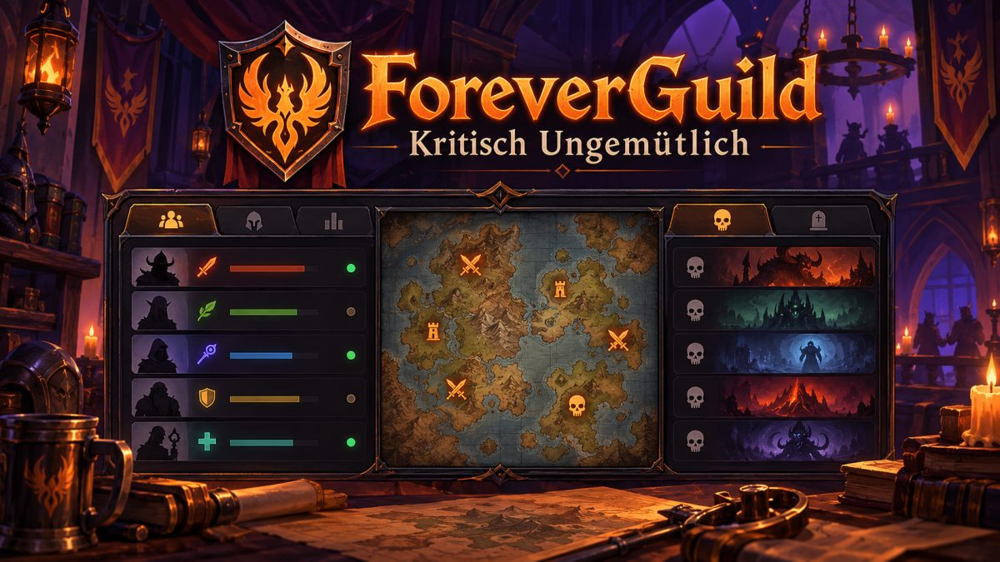
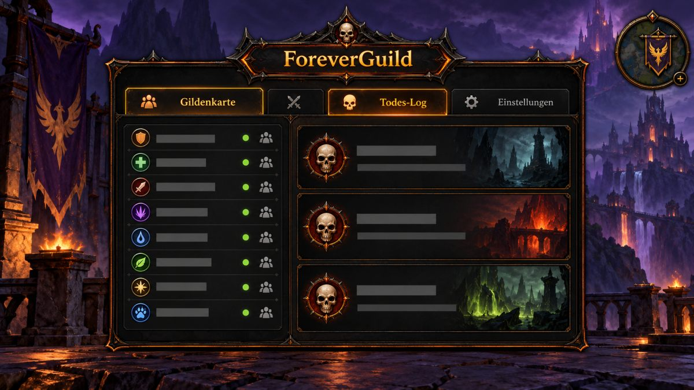

# ForeverGuild

World of Warcraft Forever guild addon by Kritisch Ungemütlich.

  

  

The addon icon is available at [`assets/foreverguild-icon-small.png`](assets/foreverguild-icon-small.png).

## Installation

1. Download this repository as a ZIP.
2. Copy the `ForeverGuild` folder into the Forever client’s `Interface/AddOns/` folder.
3. In the character-selection screen, enable the addon. If it is marked out of date, enable “Load out of date AddOns”.
4. Log in and run `/reload` once.

## Commands

- `/ku` or `/fg` — open the guild list.
- `/ku opt` — open addon settings.
- `/ku hilfe` — show all commands.
- `/ku tod` — open the death log.
- `/ku pvp` — toggle the PvP warning.
- `/ku test` — send clearly synthetic `[KU]` sample messages to guild chat.

## Chat logging

The optional chat-log setting is intended for the separate Discord bridge. Enable it with `/chatlog` or in `/ku opt`. Forever clients may flush `WoWChatLog.txt` only when the game exits; the addon does not repeatedly toggle logging because that can clear or rotate the file.

`/ku test` uses synthetic sample values and does not represent the character’s real level or professions.

## Scope

This repository contains the ForeverGuild addon only. The Discord bridge is maintained separately.

